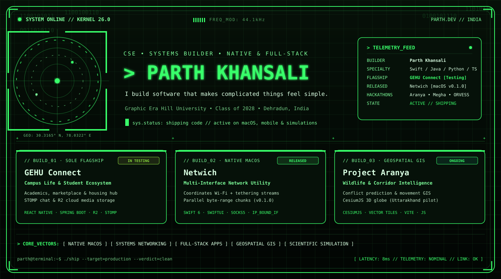
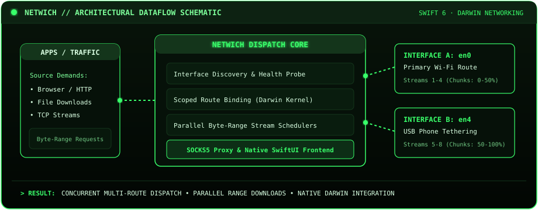
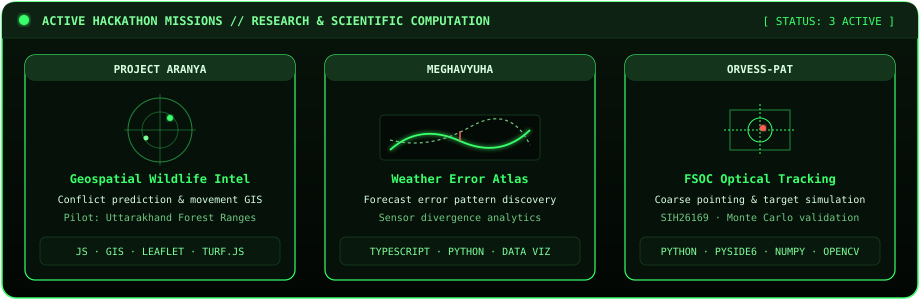

<div align="center">

<p align="center">
  
</p>

### `PARTH KHANSALI`

`CSE STUDENT` · `NATIVE & FULL-STACK BUILDER` · `SYSTEMS & SIMULATION`

<br/>

<a href="https://github.com/ParthKhansali">
  
</a>
&nbsp;
<a href="https://www.linkedin.com/in/parth-khansali/">
  
</a>
&nbsp;
<a href="mailto:parthkhansali@gmail.com">
  
</a>
&nbsp;
<a href="https://github.com/ParthKhansali/E-Portfolio">
  
</a>

<br/><br/>

<p align="center">
  
</p>

<p align="center">
  
</p>

</div>

## `whoami`

> *"I build software that makes complicated things feel simple."*

I'm **Parth**, a third-year Computer Science student at **Graphic Era Hill University** (Class of 2028) in Dehradun, India.

When something doesn't work the way I think it should, my first instinct is to pull it apart, understand the internals, and see if I can make it better. What excites me isn't checking off framework boxes. I like tackling problems where the plumbing underneath is complex, but the product in the user's hand feels effortless.

That spans low-level native macOS networking in **Netwich**, designing campus-wide mobile systems in **GEHU Connect**, and running scientific simulations or geospatial pipelines for hackathons (**Project Aranya**, **MeghaVyuha**, and **ORVESS-PAT**).

Beyond code, I value clear communication. Leading my university's Model UN club as Director General taught me how to debate, organize teams, and explain technical ideas without hiding behind buzzwords.

<div align="center">
  
</div>

## `flagship.systems`

<div align="center">
  
</div>

<br/>

<table>
<tr>
<td width="50%" valign="top">

### `01` · <a href="https://github.com/ParthKhansali/Netwich">Netwich</a>

**Native macOS Multi-Interface Network Utility** · `[STATUS: COMPLETED]`

Netwich is a lightweight Mac utility that distributes network traffic across multiple active connections (Wi-Fi and phone USB tethering) and accelerates downloads through parallel byte-range requests.

**Technical Architecture:**
* Discovers and monitors physical Darwin network interfaces dynamically.
* Binds outbound TCP sockets to specific interfaces on macOS.
* Maintains interface-scoped routes so tethering remains usable even when Wi-Fi is the primary default route.
* Slices large downloads into concurrent byte-range chunks with graceful single-stream fallback.
* Native SwiftUI interface communicating through a lightweight local SOCKS5 proxy.

`Swift 6` `SwiftUI` `Darwin Networking` `POSIX Sockets` `SOCKS5`

<details>
<summary><b>View Engineering Deep Dive</b></summary>
<br/>
The core challenge was Darwin interface-scoped routing. On macOS, default routing tables funnel all traffic through one primary interface. Netwich binds outbound streams to specific interface indexes (such as <code>en0</code> and <code>en4</code>), maintaining persistent throughput even during route switches.
</details>

</td>
<td width="50%" valign="top">

### `02` · <a href="https://gehuconnect.in">GEHU Connect</a>

**Campus Ecosystem Mobile Platform** · `[STATUS: IN TESTING]`

A student-first mobile platform bringing campus life into one unified space: peer community networking, academic resources, a student marketplace, and campus housing discovery.

**Technical Architecture:**
* React Native and Expo client delivering a responsive mobile experience.
* Java Spring Boot REST backend with JWT authentication and modular service layers.
* Cloudflare R2 object storage integration for fast image and file uploads via presigned URLs.
* Firebase Cloud Messaging (FCM) dispatching campus updates and notification feeds.
* Designed to eliminate the need for students to jump between disconnected portals.

`React Native` `Expo` `Java` `Spring Boot` `Cloudflare R2` `FCM`

<details>
<summary><b>View Engineering Deep Dive</b></summary>
<br/>
Organized around high-frequency student interactions: Home, Academics, Marketplace, Housing, and Profile. Built to scale gracefully for thousands of active daily campus users with optimized image caching and token-based sessions.
</details>

</td>
</tr>
</table>

<div align="center">
  
</div>

## `applied.intelligence & simulation`

<div align="center">
  
</div>

<br/>

<table>
<tr>
<td width="50%" valign="top">

### `03` · <a href="https://github.com/ParthKhansali/Project-Aranya">Project Aranya</a>

**Geospatial Wildlife Intelligence & FRA Platform** · `Hackathon Project`

Geospatial intelligence platform for India focused on predicting human-wildlife conflict hotspots, monitoring animal movement corridors, and supporting evidence-based conservation response.

* Evaluates spatial data layers across Uttarakhand forest ranges.
* Visual decision-support interface combining Leaflet mapping with spatial analysis tools.
* Connected with Forest Rights Act (FRA) spatial boundary contexts to aid conservation planning.

`JavaScript` `GIS` `Leaflet` `Turf.js` `Spatial Telemetry`

</td>
<td width="50%" valign="top">

### `04` · <a href="https://github.com/ParthKhansali/MeghaVyuha">MeghaVyuha</a>

**Weather Prediction Error Atlas & Analytics** · `Hackathon Project`

An analytical tool and interactive Error Atlas investigating patterns where numerical weather forecasts diverge from ground-truth sensor measurements.

* Pinpoints regional divergence patterns between predictions and physical weather stations.
* Models error variance surfaces to give meteorologists actionable visual feedback.
* Turns complex statistical discrepancies into intuitive visual maps.

`TypeScript` `Python` `Data Visualisation` `Error Modeling`

</td>
</tr>

<tr>
<td colspan="2" valign="top">

### `05` · ORVESS-PAT

**FSOC Coarse Pointing, Acquisition & Tracking Simulation** · `Hackathon Research (SIH26169)`

An engineering prototype in the Free Space Optical Communications (FSOC) coarse pointing, acquisition, and tracking domain.

* Python-based scientific simulation evaluating beam acquisition control loops under dynamic jitter and drift.
* Desktop visualization interface providing real-time optical frame telemetry.
* Run through repeatable Monte Carlo experiment runs to quantify pointing accuracy and convergence latency.

`Python 3.10+` `PySide6` `NumPy` `SciPy` `OpenCV` `Matplotlib`

</td>
</tr>
</table>

<div align="center">
  
</div>

## `tech.arsenal`

<p align="center">
  
</p>

```text
SYSTEMS & NATIVE      Swift 6, SwiftUI, macOS Darwin Networking, POSIX Sockets, SOCKS5
CORE LANGUAGES        Java, Python, C++, TypeScript, JavaScript, SQL
FRONTEND & MOBILE     React Native, Expo, React, Next.js, Tailwind CSS
BACKEND & SERVICES    Spring Boot, Node.js, Express, REST APIs
DATABASES & CLOUD     PostgreSQL, MongoDB, MySQL, Cloudflare R2, AWS, Firebase
SCIENTIFIC & GIS      NumPy, SciPy, OpenCV, Matplotlib, PySide6, Leaflet, Turf.js
TOOLING & WORKFLOW    Git, GitHub Actions, Figma, Linux/Unix, Postman
```

<div align="center">
  
</div>

## `engineering.philosophy`

```text
[01] TRICKY INTERNALS -> CLEAN UTILITY
     Deconstruct complex OS networking or system behavior into a focused tool (Netwich).

[02] REAL CAMPUS NEEDS -> COHESIVE PRODUCT
     Connect fragmented daily student life into a reliable mobile experience (GEHU Connect).

[03] SPATIAL & WEATHER DATA -> DECISION SUPPORT
     Translate geographic layers and prediction errors into visual intelligence (Aranya, MeghaVyuha).

[04] RIGOROUS SIMULATION -> EMPIRICAL EVIDENCE
     Test and measure technical hypotheses through repeatable scientific computing (ORVESS-PAT).
```

<div align="center">
  
</div>

## `leadership & field`

```text
Director General: University Model UN Club
├── Directed 2 college-scale conferences with 200+ delegates
├── Led outreach campaigns across 15 to 20 regional schools
└── Competed in 4 conferences (2 delegate awards, including IIT Roorkee participation)

Apple + Infosys: iOS Student Developer Program
└── Selective hands-on program in native iOS architecture, Swift, and Apple platform patterns
```

<div align="center">
  
</div>

## `connect`

<div align="center">

<a href="https://github.com/ParthKhansali">
  
</a>
&nbsp;
<a href="https://www.linkedin.com/in/parth-khansali/">
  
</a>
&nbsp;
<a href="mailto:parthkhansali@gmail.com">
  
</a>
&nbsp;
<a href="https://github.com/ParthKhansali/E-Portfolio">
  
</a>

<br/><br/>

```text
parth@workstation:~$ ./status --report
> BUILD USEFUL SOFTWARE. SHIP IT CLEAN.
```

</div>
